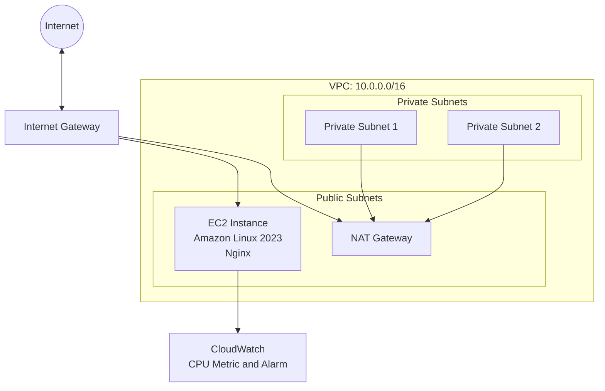

# AWS Secure Linux Web Server

A hands-on AWS cloud engineering project focused on deploying and monitoring a Linux web server within a custom VPC.

## Project Overview

This project demonstrates the deployment of a Linux-based web server using AWS infrastructure. It covers networking, compute, security, Linux administration, web server configuration and cloud monitoring.

## Architecture

**AWS Region:** Europe (London) — `eu-west-2`

The infrastructure includes:

- Custom VPC with CIDR `10.0.0.0/16`
- Two public subnets across two Availability Zones
- Two private subnets across two Availability Zones
- Internet Gateway for public subnet connectivity
- NAT Gateway for private subnet outbound connectivity
- EC2 instance running Amazon Linux 2023
- Nginx web server serving a custom webpage
- CloudWatch CPU monitoring and alarm

### Architecture Diagram

## Technologies Used

| Technology | Purpose |
|---|---|
| AWS VPC | Network isolation |
| Public and private subnets | Network segmentation |
| Internet Gateway | Public internet connectivity |
| NAT Gateway | Outbound internet access for private subnets |
| Amazon EC2 | Virtual server hosting |
| Amazon Linux 2023 | Linux operating system |
| Nginx | Web server |
| AWS CloudWatch | Monitoring and alerting |
| SSH | Secure remote administration |

## Security Configuration

- SSH access restricted to a specific administrator IP address.
- HTTP traffic permitted on port 80 for public website access.
- EC2 instance deployed in a public subnet.
- Private subnets use a NAT Gateway for outbound connectivity.

## Monitoring

Configured an Amazon CloudWatch alarm:

- **Metric:** EC2 CPUUtilization
- **Statistic:** Average
- **Evaluation period:** 5 minutes
- **Threshold:** Greater than 70%
- **Alarm name:** `secure-web-server-high-cpu`

The alarm reached the **OK** state, confirming that the monitored CPU utilisation was below the configured threshold at that time.

No SNS notification or automated recovery action was configured.

## Key Learning Outcomes

- Designing AWS VPC networking.
- Configuring public and private subnets.
- Understanding internet and NAT gateways.
- Deploying and accessing an EC2 Linux instance.
- Managing Linux packages and services.
- Installing and configuring Nginx.
- Applying security group rules.
- Monitoring infrastructure using CloudWatch.

## Architecture Considerations

This is a learning project, not a production-ready deployment.

The environment uses one EC2 instance and one NAT Gateway. The NAT Gateway is located in one Availability Zone, so it represents a potential availability dependency. HTTPS, high availability and automated recovery are potential future improvements.

## Project Evidence

Screenshots and supporting documentation will be added to the `screenshots/`, `architecture/` and `docs/` directories.

## Author

Cloud engineering learning project — AWS, Linux and infrastructure fundamentals.
