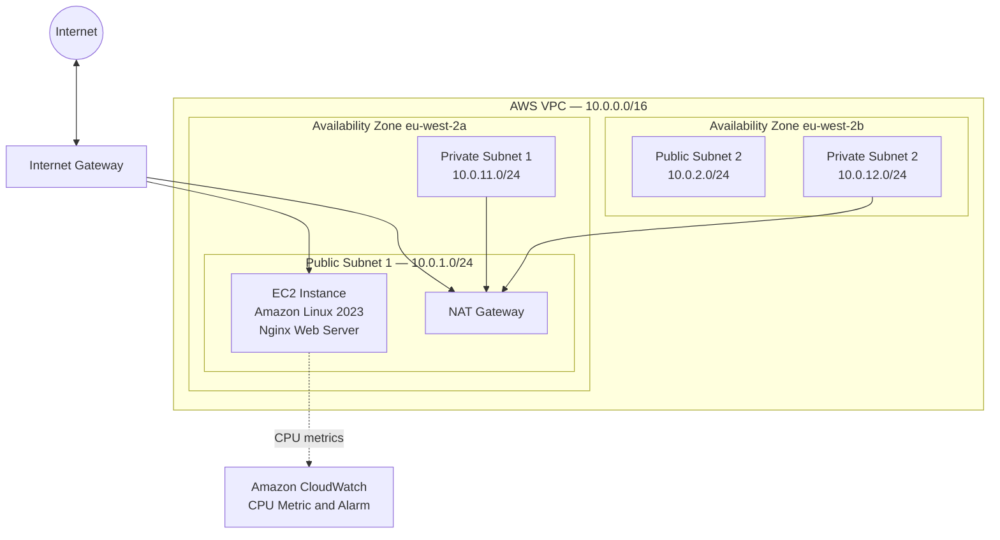

# AWS Infrastructure Architecture

This diagram represents the AWS infrastructure deployed in the London region (`eu-west-2`).

**Network design notes:**
- Public subnets use the Internet Gateway for internet connectivity.
- Private subnets route outbound internet traffic through the NAT Gateway.
- The NAT Gateway is located in Availability Zone `eu-west-2a`.
- The EC2 web server is deployed in public subnet 1.
- CloudWatch monitors EC2 CPU utilisation.
